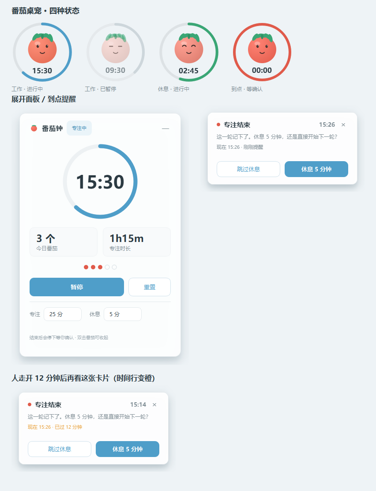

# 番茄桌宠 Pomodoro Pet

一个常驻屏幕右下角的桌面番茄钟：一颗会跳、会眨眼的小番茄 + 到点不消失的提醒卡片。



Windows / Python 3.10+ / PyQt6，单文件程序，不需要联网、不读你的文件。

## 下载（不想折腾代码的看这里）

到 [Releases](../../releases) 下载 `番茄桌宠_v1.0.zip`，解压后：

- 想最省事：双击 `PomodoroPet.exe`，右下角出现小番茄就能用了（**不用装 Python**）
- 想要桌面图标：双击 `安装到本机.bat`，桌面会多一个「番茄桌宠」

首次运行 Windows 可能提示"已保护你的电脑"，点「更多信息」→「仍要运行」。
360 / 火绒也可能拦一下，选允许/信任即可——它不联网。

## 功能

- **悬浮桌宠**：140px 无边框置顶小番茄，不在任务栏占位置，拖动换位置会记住
- **展开面板**：双击番茄，看今日番茄数、专注时长、改工作/休息时长
- **到点三层提醒**：番茄跳三下 + 三声提示音 + 右下角置顶卡片（不点不消失）
- **错过也知道多久**：卡片右上角是提醒时刻，下面实时显示「现在几点 · 已过 N 分钟」，超过 5 分钟变橙
- **结束即暂停**：不自动跳下一轮，等你点「休息」或「开始下一轮」
- **今日统计**：番茄个数、累计专注时长，跨天自动归档
- **单实例**：重复双击不会开两个，第二个会安静退出

## 用法

```
双击番茄        展开 / 收起面板
拖动番茄        换位置（多屏可以拖到另一块屏幕）
右键番茄        开始 / 重置 / 展开 / 退出
右键托盘图标    同上
```

设置和统计存在 `%APPDATA%\PomodoroPet\pomodoro_state.json`，
删掉它就恢复默认设置、清空统计。

想让电脑开机自动出现：`Win+R` → `shell:startup` → 把快捷方式放进去。

## 从源码运行

```bash
pip install PyQt6
python pomodoro_pet.py
```

无黑窗启动（Windows）：

```bat
@echo off
cd /d "%~dp0"
start "" "pythonw.exe" "%~dp0pomodoro_pet.py"
```

## 自己打包成 exe

```bash
pip install pyinstaller pillow
python make_icon.py          # 生成多尺寸 ico
python -m PyInstaller --onefile --windowed --name PomodoroPet \
  --icon assets/pomodoro.ico \
  --exclude-module tkinter --exclude-module unittest \
  --exclude-module PyQt6.QtNetwork --exclude-module PyQt6.QtQml \
  --exclude-module PyQt6.QtQuick --exclude-module PyQt6.QtSql \
  --exclude-module PyQt6.QtTest --exclude-module PyQt6.QtXml \
  --exclude-module PyQt6.QtPrintSupport pomodoro_pet.py
python gen_dist.py           # 生成带说明和安装脚本的 zip
```

PyQt6 全量 215MB，排除掉用不到的模块后是 **34.9MB**，冷启动 1.3 秒。

## 测试

```bash
cd tests
python test_logic.py          # 状态机 / 统计 / 持久化
python test_interaction.py    # 双击 / 拖动 / 按钮回调
python test_app_wiring.py     # 到点 → 卡片 → 休息 → 下一轮 全流程
python test_notice_clock.py   # 提醒卡片的时间行文案边界
python test_position.py       # 多屏位置夹取，拖到屏幕外能回来
python test_shots.py          # 生成 screenshots/ 下的视觉验收图
```

## 几个实现上的坑（给后来人）

- **不要用 plyer 做 Windows 通知**：它走 `Shell_NotifyIconW + NIF_INFO`（Win7 托盘气球），
  Win10/11 已废弃这条 API——调用不报错、界面什么都不出。这里改用自家置顶卡片 + `winsound`。
- **正好 360° 的 `drawArc` 画不出来**（首尾重合），满环要用 `drawEllipse` 描边。
- **托盘程序打包后别把存档写在 exe 旁边**：`__file__` 会指向临时解包目录，重启就丢。
  用 `%APPDATA%\<AppName>\`。
- **单实例锁的 `setStaleLockTime(0)` 是个陷阱**：进程被杀会留下永久锁，之后每次启动都静默失败。
- **窗口位置要按多屏校验**，只判断主屏会把副屏上的窗口强行拉回来。

## License

MIT
